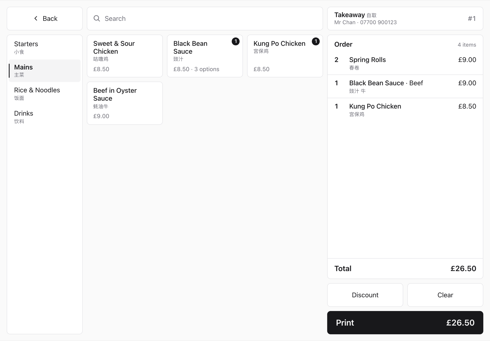

# PiPOS

A free, open-source POS for takeaways and small shops. No monthly fees, no contract. It runs on a free Netlify site, a tablet you probably already have, and a £15 Raspberry Pi wired to a thermal printer.



## What it costs

| | |
|---|---|
| Software | £0, forever (MIT licence) |
| Hosting | £0 on Netlify's free plan |
| Raspberry Pi Zero 2 W | about £15, plus about £10 for an SD card, power supply and USB adapter |
| 80mm thermal printer | £50–80 (Xprinter, Munbyn, or any ESC/POS printer) |
| Tablet | any with a browser. Use one you have, or a cheap Android tablet |

**About £75–105 once, then nothing.**

PiPOS is built to stay well inside the free plan. Saving your menu or layout doesn't trigger a new deploy, and the printer waits for a push instead of checking the server all day.

## Compared with the usual options

Software fees for one till, UK, before VAT, roughly as of late 2026. Prices change, so check before you decide.

| | Monthly | 5 years of fees | Notes |
|---|---|---|---|
| **PiPOS** | **£0** | **£0** | You host it yourself |
| Square for Restaurants (Free) | £0 | £0 | Card payments must go through Square (1.75%), and their hardware costs £99–149+ |
| Square for Restaurants (Plus) | £69 | £4,140 | |
| Epos Now | ~£25–54 | £1,500–3,240 | Usually a 12-month contract; add-ons extra |
| Lightspeed Restaurant | from £79 | £4,740 | |
| Toast | from £80 | £4,800 | Plus card fees; terminals £500+ |

What you give up compared with the paid systems:

- **Card payments.** PiPOS takes orders and prints them. For cards, use a separate pay-as-you-go reader such as SumUp or a Square Reader (about 1.7% per transaction, no monthly fee).
- **Online ordering, stock control and a support line.** You run it yourself; the [guide](https://snakeluck360gt.github.io/pi-pos/) covers setup step by step.

What you get that they don't: every screen and every receipt line is yours to change, Chinese and other second-language names print large on the receipt, and your data sits on your own Netlify account.

## What it does

- Drag-and-drop editor for the tablet screens: move, resize and restyle every button, list and label
- Receipt designer with text sizes from 1× to 8×, bold, underline, white-on-black and a live preview
- Import a menu from a PDF or pasted text
- Takeaway and delivery, item options like "no onion", discounts, a daily summary and a print queue
- Prints within a couple of seconds of tapping Print. If the connection drops, the tablet keeps its menu and you retry the print

## Setup

[](https://app.netlify.com/start/deploy?repository=https://github.com/SnakeLuck360GT/pi-pos)

1. Click the button above and pick an admin password.
2. Open `your-site.netlify.app/admin` and follow the setup.
3. Paste the one-line command it gives you into the Raspberry Pi.
4. Open the site on your tablet.

The full guide, with pictures, is at **https://snakeluck360gt.github.io/pi-pos/**.

## Development

```
npm install
echo ADMIN_PASSWORD=dev > .env
npx netlify dev     # http://localhost:8888
npm test
```

MIT licence. Pull requests welcome.
